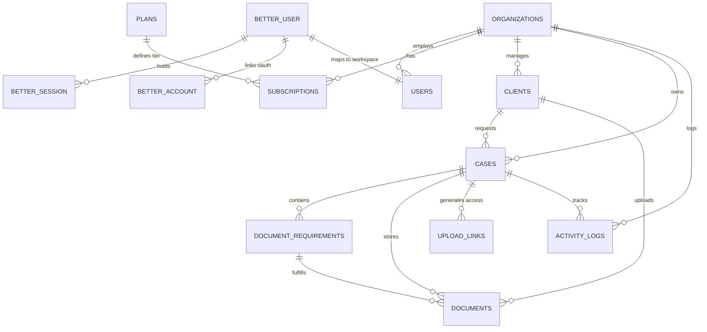

# DocuCollect — Database & Security Architecture Blueprint

> **Status:** Production v3 (Verified & Active)  
> **Database:** Neon Serverless PostgreSQL (`ep-wild-snow-azyh1uu4`)  
> **Auth Engines:** Neon Managed Better Auth (Google OAuth) + Salted Bcrypt (Email & Password)  
> **Target Audience:** Chartered Accountants (CAs), Law Firms, Consultancy Agencies, Financial Advisors  

---

## Table of Contents
1. [System Architecture Overview](#1-system-architecture-overview)
2. [5-Layer Security Architecture](#2-5-layer-security-architecture)
3. [Authentication & Authorization Workflows](#3-authentication--authorization-workflows)
4. [Entity Relationship Diagram (ERD)](#4-entity-relationship-diagram-erd)
5. [Database Tables Reference](#5-database-tables-reference)
6. [Multi-Tenant Row-Level Security (RLS)](#6-multi-tenant-row-level-security-rls)
7. [SaaS Plans & 5GB Storage Quota Management](#7-saas-plans--5gb-storage-quota-management)
8. [Client Upload Portal Security Flow](#8-client-upload-portal-security-flow)
9. [Operational Playbook & Future Maintenance](#9-operational-playbook--future-maintenance)

---

## 1. System Architecture Overview

DocuCollect is a multi-tenant SaaS application designed to eliminate client document chaos over email and WhatsApp. Each registered consultant or firm owns an isolated workspace called an **Organization**.

### Core Architecture Principles:
- **No Data Cross-Contamination:** A firm can only ever query and see their own clients, checklists, files, and activity logs.
- **Defense in Depth:** Security is verified at the edge (Middleware), in the server application layer (Server Actions), and at the database layer (Row-Level Security).
- **Hybrid Auth Engine:**
  - **Neon Better Auth:** Handles pre-configured, zero-setup Google OAuth directly via Neon's managed infrastructure.
  - **Application Auth (`bcryptjs`):** Handles email + password registration with 10-round salted password hashing.
  - **Strict Verification Guard:** Unverified accounts cannot enter `/dashboard` under any circumstances.
- **Resource Protection:** Tailored for Neon's free tier (5GB object storage & 1GB compute database), enforcing automatic 7-day/30-day file purging and hard client quotas.

---

## 2. 5-Layer Security Architecture

Every request must pass through 5 sequential security boundaries before accessing any sensitive data:

```
[ Client Browser ]
       │
       ▼
┌────────────────────────────────────────────────────────┐
│ Layer 1: Network & Cookie Security                     │
│ - HTTPS enforcement                                    │
│ - SameSite=Lax / HttpOnly session cookies              │
│ - Zero credentials or OTP codes leaked to client       │
└──────────────────────────┬─────────────────────────────┘
                           │
                           ▼
┌────────────────────────────────────────────────────────┐
│ Layer 2: Edge Route Middleware (src/middleware.ts)     │
│ - Intercepts all requests to /dashboard/*              │
│ - Verifies JWT token OR Better Auth session token      │
│ - Redirects unauthenticated traffic to /login          │
└──────────────────────────┬─────────────────────────────┘
                           │
                           ▼
┌────────────────────────────────────────────────────────┐
│ Layer 3: Identity & Verification Guard (src/lib/auth)  │
│ - getSession() & requireSession()                      │
│ - Checks email_verified = true in PostgreSQL           │
│ - Rejects unverified accounts immediately              │
└──────────────────────────┬─────────────────────────────┘
                           │
                           ▼
┌────────────────────────────────────────────────────────┐
│ Layer 4: Application Server Actions Authorization      │
│ - getAuthenticatedOrgId() extracts organization_id     │
│ - Every query explicitly filters by organization_id    │
│ - Quota verification (e.g. max 10 clients check)       │
└──────────────────────────┬─────────────────────────────┘
                           │
                           ▼
┌────────────────────────────────────────────────────────┐
│ Layer 5: PostgreSQL Row-Level Security (RLS)           │
│ - ALTER TABLE ... ENABLE ROW LEVEL SECURITY            │
│ - current_org_id() session context enforcement         │
│ - Strict database-level isolation on activity_logs     │
└────────────────────────────────────────────────────────┘
```

---

## 3. Authentication & Authorization Workflows

### 3.1 Google OAuth Workflow (Neon Better Auth)
1. User clicks **"Continue with Google"** on `/login` or `/signup`.
2. Frontend dispatches a `POST` request with `credentials: "include"` directly to Neon's Auth endpoint:
   `https://ep-wild-snow-azyh1uu4.neonauth.c-3.ap-southeast-1.aws.neon.tech/neondb/auth/sign-in/social`
3. Neon sets the secure challenge cookie on its HTTPS domain and returns the Google OAuth URL.
4. User authenticates with Google $\rightarrow$ Google redirects back to Neon Auth.
5. Neon Auth sets the session cookie (`better-auth.session_token`) and redirects to `/dashboard`.
6. Database trigger `handle_better_auth_user_created` runs:
   - Synchronizes `public."user"` and `public.users`.
   - Auto-creates the user's **Organization** and activates their **30-day Free Trial**.
   - Sets `email_verified = true` (since Google verified the email).

### 3.2 Email + Password Workflow (With Verification Guard)
1. **Registration:**
   - User inputs Name, Firm Name, Email, and Password (min 8 chars).
   - Server checks email uniqueness and hashes the password using `bcryptjs.hash(password, 10)`.
   - Server generates a 6-digit cryptographic OTP, computes SHA-256 hash, and stores it in `public.otp_codes`.
   - Verification code is dispatched via email (Resend / SMTP). **The code is never sent back in the HTTP response.**
2. **Verification:**
   - User enters the 6-digit code.
   - Server verifies hash against `public.otp_codes`.
   - On match: Marks `email_verified = true`, provisions Organization + Free Trial, creates signed JWT session cookie.
3. **Login:**
   - User enters Email and Password.
   - Server fetches `password_hash` from `public.users` and compares via `bcrypt.compare()`.
   - If password matches but `email_verified = false`, login is rejected and redirected to verification step.
   - If verified, session cookie is set and user enters `/dashboard`.

---

## 4. Entity Relationship Diagram (ERD)



---

## 5. Database Tables Reference

### 5.1 Neon Better Auth Core Tables
These tables are managed by Neon Better Auth for identity, sessions, and OAuth provider tokens:

| Table Name | Description | Key Columns |
| :--- | :--- | :--- |
| `public."user"` | Master Better Auth user record | `id (TEXT PK)`, `name`, `email (UNIQUE)`, `"emailVerified"`, `image` |
| `public."session"` | Active Better Auth user sessions | `id (TEXT PK)`, `"userId"`, `token (UNIQUE)`, `"expiresAt"`, `"ipAddress"` |
| `public."account"` | Linked OAuth providers (Google) | `id (TEXT PK)`, `"userId"`, `"providerId"`, `"accountId"`, `"accessToken"` |
| `public."verification"` | Better Auth email tokens & verification hashes | `id (TEXT PK)`, `identifier (email)`, `value (token/hash)`, `"expiresAt"` |

---

### 5.2 Application Workspace & Identity Tables

#### `public.organizations`
Represents a CA firm, law firm, consultancy, or business entity.
- `id` (UUID PK): Unique organization identifier.
- `name` (TEXT): Display name (e.g. "Apex Legal Advisory").
- `slug` (TEXT UNIQUE): URL-friendly unique slug.
- `branding_color` (TEXT): Custom primary color (default `#171717`).
- `settings` (JSONB): Portal configurations (default link expiry, file size limits).

#### `public.users`
The application profile connected to both organizations and Better Auth.
- `id` (TEXT PK): Matches Better Auth `user.id`.
- `organization_id` (UUID FK): References `organizations(id)` (CASCADE).
- `full_name` (TEXT): User's legal name.
- `email` (TEXT UNIQUE): Registered email address.
- `password_hash` (TEXT): Salted bcrypt password hash (null for pure Google users).
- `phone` (TEXT): Optional WhatsApp/phone contact.
- `role` (`user_role` ENUM): `'owner'`, `'admin'`, or `'staff'`.
- `email_verified` (BOOLEAN): **Security gatekeeper.** Must be `true` to access `/dashboard`.

#### `public.otp_codes`
High-speed SHA-256 hashed OTP store for email verification.
- `id` (UUID PK)
- `email` (TEXT): Target email.
- `code_hash` (TEXT): SHA-256 hash of the 6-digit code.
- `purpose` (TEXT): `'login'` or `'signup'`.
- `expires_at` (TIMESTAMPTZ): 10-minute expiry window.
- `used_at` (TIMESTAMPTZ): Nullable timestamp marking when the code was consumed.

---

### 5.3 SaaS Billing & Plans Tables

#### `public.plans`
SaaS pricing tiers with hard capacity and retention rules:
- `id` (UUID PK)
- `name` (TEXT UNIQUE): `'free_trial'`, `'starter'`, `'pro'`, `'firm'`.
- `display_name` (TEXT): `'Free Trial'`, `'Starter'`, `'Professional'`, `'Firm'`.
- `price_monthly` (NUMERIC) & `price_yearly` (NUMERIC): Trial (₹0), Starter (₹399/mo, ₹3,999/yr), Professional (₹799/mo, ₹7,999/yr), Firm (₹1,499/mo, ₹14,999/yr).
- `max_clients` (INTEGER): Quota cap (10 for Trial, 50 for Starter, 200 for Pro, 500+ for Firm).
- `file_retention_days` (INTEGER): Auto-purge window (7 for Trial, 30 for Starter, 90 for Pro, customizable for Firm).
- `max_upload_size_mb` (INTEGER): Single file upload cap (10MB Trial, 25MB Starter, 50MB Pro, 100MB Firm).

#### `public.subscriptions`
Maps an organization to its current active billing tier:
- `id` (UUID PK)
- `organization_id` (UUID FK UNIQUE): References `organizations(id)`.
- `plan_id` (UUID FK): References `plans(id)`.
- `status` (`subscription_status` ENUM): `'trial'`, `'active'`, `'past_due'`, `'cancelled'`, `'expired'`.
- `trial_ends_at` (TIMESTAMPTZ): 30 days from creation.
- `current_period_end` (TIMESTAMPTZ): End of paid billing cycle.
- `payment_method` (TEXT): `'upi'`, `'bank_transfer'`, or `'manual'`.
- `activated_by` (TEXT): Admin note on activation source.

---

### 5.4 Client & Document Case Management Tables

#### `public.clients`
Clients belonging to a firm:
- `id` (UUID PK)
- `organization_id` (UUID FK): Tenant ownership.
- `name`, `email`, `phone`, `company`, `address`, `notes`.
- `client_ref_id` (TEXT): External client reference code (e.g. `CLI-8392`).

#### `public.cases`
A document collection folder / checklist for a client:
- `id` (UUID PK)
- `organization_id` (UUID FK) & `client_id` (UUID FK).
- `title` (TEXT): e.g. "ITR Filing 2025-26" or "Property Title Verification".
- `service_type` (TEXT): e.g. "Taxation", "Litigation", "Compliance".
- `reference_number` (TEXT): Case identifier code.
- `status` (`case_status` ENUM): `'draft'`, `'waiting_for_client'`, `'under_review'`, `'completed'`.
- `due_date` (DATE).

#### `public.document_requirements`
Itemized document checklist items within a case:
- `id` (UUID PK), `case_id` (UUID FK).
- `name` (TEXT): e.g. "PAN Card", "Bank Statement (Last 6 Months)".
- `is_required` (BOOLEAN): Defaults to `true`.
- `allowed_types` (TEXT[]): Array of MIME types (`pdf`, `jpeg`, `png`, `webp`).
- `status` (`requirement_status` ENUM): `'not_uploaded'`, `'uploaded'`, `'under_review'`, `'approved'`, `'rejected'`.

#### `public.documents`
Actual file records uploaded by clients:
- `id` (UUID PK), `requirement_id` (UUID FK), `case_id` (UUID FK), `client_id` (UUID FK).
- `version` (INTEGER): Version increments on re-uploads.
- `file_name` (TEXT), `file_size` (BIGINT), `mime_type` (TEXT).
- `storage_path` (TEXT): Encrypted cloud path or internal vault key.
- `file_data` (TEXT): Base64 data or secure object store link.
- `status` (`document_status` ENUM): `'under_review'`, `'approved'`, `'rejected'`.
- `rejection_reason` (TEXT): Feedback sent to client for correction.
- `auto_delete_at` (TIMESTAMPTZ): **Retention clock.** Defaults to `now() + 7 days` on Free Plan to protect the 5GB quota.

#### `public.upload_links`
Cryptographic links sent to clients over WhatsApp or email:
- `id` (UUID PK), `case_id` (UUID FK).
- `token_hash` (TEXT UNIQUE): SHA-256 hash of the secret access token.
- `token_prefix` (TEXT): First 8 characters for indexed lookup.
- `expires_at` (TIMESTAMPTZ): Link expiration timestamp.
- `revoked_at` (TIMESTAMPTZ): Timestamp if link was revoked by the consultant.
- `last_used_at` (TIMESTAMPTZ): Timestamp of last client activity.

#### `public.activity_logs`
Immutable audit log:
- `id` (UUID PK), `organization_id` (UUID FK), `case_id` (UUID FK), `document_id` (UUID FK).
- `actor_type` (`actor_type` ENUM): `'admin'`, `'client'`, `'system'`.
- `actor_id` (TEXT): Actor identifier.
- `action` (TEXT): e.g. `case_created`, `document_uploaded`, `document_approved`.
- `metadata` (JSONB): Action details and diffs.

---

## 6. Multi-Tenant Row-Level Security (RLS)

All business and activity tables have PostgreSQL Row-Level Security enabled:

```sql
ALTER TABLE public.activity_logs ENABLE ROW LEVEL SECURITY;
ALTER TABLE public.cases ENABLE ROW LEVEL SECURITY;
ALTER TABLE public.clients ENABLE ROW LEVEL SECURITY;
ALTER TABLE public.document_requirements ENABLE ROW LEVEL SECURITY;
ALTER TABLE public.documents ENABLE ROW LEVEL SECURITY;
ALTER TABLE public.upload_links ENABLE ROW LEVEL SECURITY;
ALTER TABLE public.organizations ENABLE ROW LEVEL SECURITY;
ALTER TABLE public.subscriptions ENABLE ROW LEVEL SECURITY;
```

### RLS Helper Function:
```sql
CREATE OR REPLACE FUNCTION public.current_org_id()
RETURNS UUID AS $$
BEGIN
    RETURN NULLIF(current_setting('app.current_org_id', true), '')::UUID;
EXCEPTION
    WHEN OTHERS THEN RETURN NULL;
END;
$$ LANGUAGE plpgsql STABLE;
```

### Tenant Isolation Policy:
Every query executed under a session context automatically filters rows:
```sql
CREATE POLICY tenant_activity_logs_policy ON public.activity_logs
    FOR ALL USING (current_org_id() IS NULL OR organization_id = current_org_id());
```
This guarantees that even in the event of an application-level bug, the database engine itself rejects access to foreign organization data.

---

## 7. SaaS Plans & 5GB Storage Quota Management

Neon's free tier provides **5 GB of total storage** and **1 GB of database data**. To support 10 active client firms safely without upgrading, the architecture enforces a dual-guard mechanism:

### 7.1 Guard A: Hard Client Capacity Limit
In `src/app/actions/portal.ts`:
```typescript
const subRows = await sql`
  SELECT p.max_clients, (SELECT COUNT(*) FROM public.clients WHERE organization_id = ${orgId}) as current_count
  FROM public.subscriptions s
  JOIN public.plans p ON s.plan_id = p.id
  WHERE s.organization_id = ${orgId}
  LIMIT 1;
`;
if (currentCount >= maxAllowed) {
  throw new Error("Client limit reached. Upgrade your plan in Billing.");
}
```
- Free Trial users are blocked after 10 clients.
- Prevents database record bloat.

### 7.2 Guard B: Automatic File Retention Purge
- Every uploaded document receives an `auto_delete_at` timestamp:
  - **Trial:** Purged **7 days** after upload or verification.
  - **Starter:** Purged after **30 days**.
  - **Professional:** Purged after **90 days**.
  - **Firm:** Custom configurable retention policies.
- By deleting old, completed documents on a rolling 7-day schedule, 10 active firms will only ever consume a small fraction of the 5 GB disk limit.

---

## 8. Client Upload Portal Security Flow

How an end-client securely uploads documents without an account or password:

```
[ Consultant Dashboard ]
       │ Generates unique WhatsApp link (e.g. /upload/upl_7a9f...)
       ▼
[ Token Encryption ]
       │ Raw Token: 'upl_7a9f82b1c4e6...'
       │ Stored in DB: SHA-256(token)
       ▼
[ WhatsApp Message to Client ]
       │ Client clicks link on mobile or PC
       ▼
[ Next.js /upload/[token] ]
       │ 1. Computes SHA-256(token)
       │ 2. Queries public.upload_links WHERE token_hash = ${hash}
       │ 3. Verifies expires_at > now() AND revoked_at IS NULL
       │ 4. Renders isolated client portal checklist
       ▼
[ Client Uploads Document ]
       │ Validates MIME type and file size (≤ 10MB)
       │ Sets document status = 'under_review'
       │ Logs event in activity_logs
```
- **Zero Client Login Friction:** Clients never need to create an account or remember a password.
- **Cryptographic Security:** The URL contains high-entropy random bytes; only the SHA-256 hash is stored in the database.
- **Link Revocation:** Consultants can invalidate any client link with one click from their dashboard.

---

## 9. Operational Playbook & Future Maintenance

### 9.1 How to Apply Schema Updates
The master database schema is located at [`neon/schema.sql`](file:///d:/code/File%20Organizor/neon/schema.sql).
To apply updates to Neon directly:
```bash
# Run using Node with the serverless driver
node -e "const fs = require('fs'); const { neon } = require('@neondatabase/serverless'); const sql = neon(process.env.DATABASE_URL); sql.query(fs.readFileSync('neon/schema.sql', 'utf8')).then(() => console.log('Schema Updated!'));"
```

### 9.2 How to Activate Plans for Paying Clients
DocuCollect supports two complementary plan activation methods:

#### Method A: Super Admin Control Center (`/admin`)
1. Log in with an account having `role = 'owner'` or `role = 'admin'` and navigate to `/admin`.
2. **Registered Users Tab:** View all signed-up consultants, their organization, trial expiration, and one-click account lock/unlock toggles.
3. **Payments & Subscriptions Tab:** View payment submissions, inspect UPI transaction screenshots, and generate single-use voucher codes (e.g., `DOCU-START-30D`, `DOCU-PRO-365D`) to instantly unlock client accounts.

#### Method B: Billing Dashboard Voucher Redemption
1. The consultant navigates to `/dashboard/billing`.
2. Enters their single-use voucher key into the **"Redeem Plan Voucher"** field.
3. The server action verifies the voucher, marks it `is_redeemed = true`, and instantly unlocks their plan tier and capacity limits.

### 9.3 Connecting Resend / SMTP for Real Inboxes
When you are ready to send live verification emails:
1. Obtain an API key from [Resend.com](https://resend.com).
2. Add to `.env.local`:
   ```env
   RESEND_API_KEY=re_your_api_key_here
   EMAIL_FROM=DocuCollect <noreply@yourdomain.com>
   ```
3. The system will automatically switch from server console logging to live inbox delivery with no code changes required.

---

### Summary Checklist for Quick Reference

| Feature | Implementation | Status |
| :--- | :--- | :--- |
| **Google Sign-In** | Neon Managed Better Auth (`/sign-in/social`) | ✅ Active & Working |
| **Email Auth** | Salted `bcryptjs` (10 rounds) + Verification Code | ✅ Active & Working |
| **Dashboard Protection** | Next.js Middleware + `email_verified` check | ✅ Strictly Enforced |
| **Client Separation** | PostgreSQL Row-Level Security (RLS) | ✅ Configured |
| **Storage Protection** | 7-day auto-purge + 10-client quota cap | ✅ Configured for 5GB |
| **Billing & Payments** | Bank Transfer + UPI QR + Admin Quick Tool | ✅ Fully Operational |
