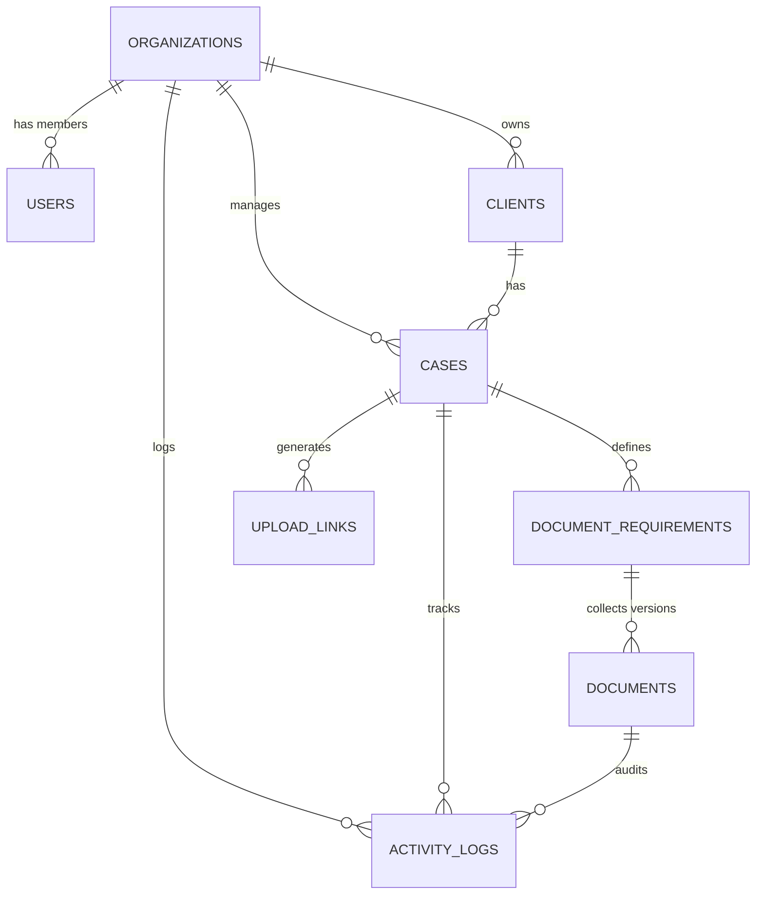
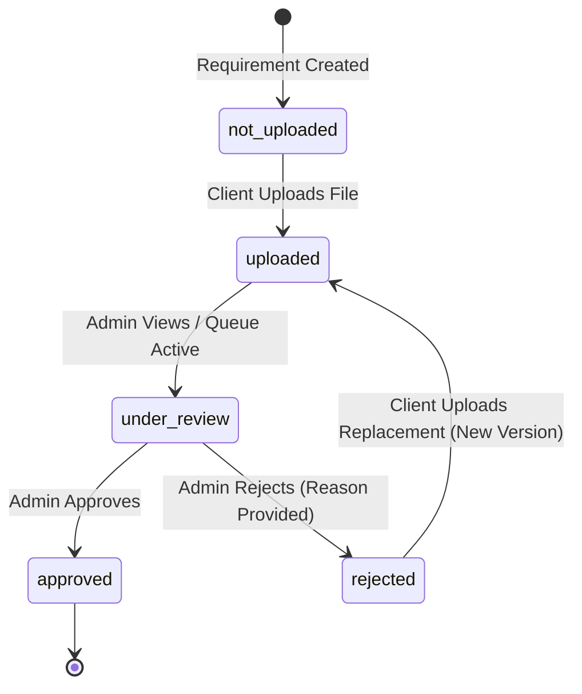
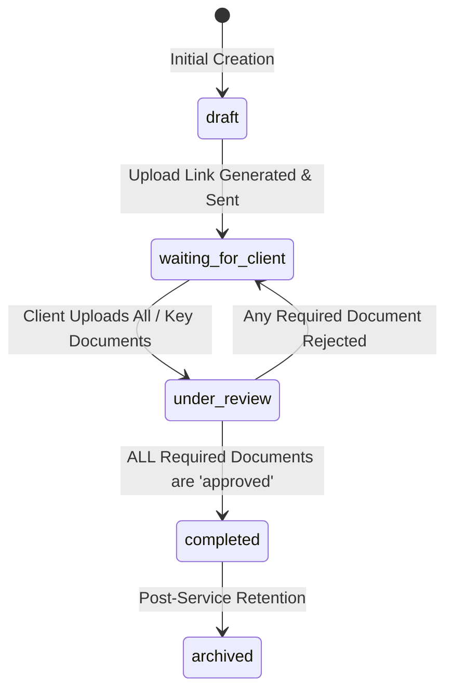

# Client Document Collection Portal — Architecture Specification

## 1. Executive Summary & Core Objectives
The **Client Document Collection Portal** solves the chaotic document collection workflow typical of professional service firms (CAs, Tax consultants, Loan officers, Legal advisors). It eliminates unstructured WhatsApp/Email file dumps by providing:
- A structured, white-label client upload portal accessed via cryptographically secure single-use/revocable links.
- Real-time document checklists with validation, instant review (Approve/Reject with feedback), version retention, and completion gating.
- Full audit trails and notification dispatching.

---

## 2. System Architecture & Topology

```mermaid
flowchart TD
    subgraph Client Layer
        BrowserClient["Client Portal (/upload/[token])\n(No Login Required)"]
        BrowserAdmin["Admin Dashboard (/dashboard)\n(Supabase Auth Session)"]
    end

    subgraph Next.js App Router Backend
        ServerActions["Server Actions & API Routes\n- Token Verification\n- Upload URL Generation\n- Document Review / Approval\n- Case & Client Management"]
        SupabaseSSR["@supabase/ssr Auth & Client Helpers\n- User Context\n- Service Role (Server-Only Token Verification)"]
    end

    subgraph Supabase BaaS
        SupabaseAuth["Supabase Auth (Admin GoTrue)"]
        PostgresDB[("Supabase PostgreSQL DB\n(RLS, Enums, Audit Triggers)")]
        PrivateStorage[("Supabase Storage\n(Private Bucket: 'client-documents')")]
    end

    subgraph Notification Service
        ResendAPI["Resend Email API / WhatsApp Web Click-to-Chat"]
    end

    BrowserAdmin -->|Auth Session| ServerActions
    BrowserClient -->|Bearer / Token Param| ServerActions
    ServerActions --> SupabaseAuth
    ServerActions --> PostgresDB
    ServerActions -->|Signed URLs (Read/Write)| PrivateStorage
    ServerActions --> ResendAPI
```

---

## 3. Database Schema Design (PostgreSQL / Supabase)

### 3.1 Entity Relationship Diagram



### 3.2 Tables & Attributes

1. **`organizations`**
   - `id` (UUID, PK, `gen_random_uuid()`)
   - `name` (TEXT, NOT NULL)
   - `slug` (TEXT, UNIQUE)
   - `logo_url` (TEXT)
   - `branding_color` (TEXT, DEFAULT '#2563eb')
   - `settings` (JSONB: default link expiry, max file size, allowed MIME types)
   - `created_at` (TIMESTAMPTZ, DEFAULT `now()`)
   - `updated_at` (TIMESTAMPTZ, DEFAULT `now()`)

2. **`users`** (Profiles linked to `auth.users`)
   - `id` (UUID, PK, REFERENCES `auth.users(id)` ON DELETE CASCADE)
   - `organization_id` (UUID, FK -> `organizations.id`, NOT NULL)
   - `full_name` (TEXT, NOT NULL)
   - `email` (TEXT, NOT NULL)
   - `role` (TEXT, DEFAULT 'admin', CHECK `role IN ('owner', 'admin', 'staff')`)
   - `created_at` (TIMESTAMPTZ, DEFAULT `now()`)
   - `updated_at` (TIMESTAMPTZ, DEFAULT `now()`)

3. **`clients`**
   - `id` (UUID, PK, `gen_random_uuid()`)
   - `organization_id` (UUID, FK -> `organizations.id`, NOT NULL)
   - `name` (TEXT, NOT NULL)
   - `email` (TEXT)
   - `phone` (TEXT, NOT NULL)
   - `alternate_phone` (TEXT)
   - `company` (TEXT)
   - `client_ref_id` (TEXT)
   - `address` (TEXT)
   - `notes` (TEXT)
   - `created_at` (TIMESTAMPTZ, DEFAULT `now()`)
   - `updated_at` (TIMESTAMPTZ, DEFAULT `now()`)

4. **`cases`**
   - `id` (UUID, PK, `gen_random_uuid()`)
   - `organization_id` (UUID, FK -> `organizations.id`, NOT NULL)
   - `client_id` (UUID, FK -> `clients.id` ON DELETE CASCADE, NOT NULL)
   - `title` (TEXT, NOT NULL)
   - `service_type` (TEXT NOT NULL, e.g., 'ITR Filing', 'GST Registration', 'Home Loan', 'Audit')
   - `reference_number` (TEXT, NOT NULL)
   - `status` (`case_status` ENUM: `'draft'`, `'active'`, `'waiting_for_client'`, `'under_review'`, `'completed'`, `'archived'`)
   - `due_date` (DATE)
   - `notes` (TEXT)
   - `created_at` (TIMESTAMPTZ, DEFAULT `now()`)
   - `updated_at` (TIMESTAMPTZ, DEFAULT `now()`)

5. **`document_requirements`**
   - `id` (UUID, PK, `gen_random_uuid()`)
   - `case_id` (UUID, FK -> `cases.id` ON DELETE CASCADE, NOT NULL)
   - `name` (TEXT, NOT NULL, e.g., 'PAN Card', 'Form 16', 'Bank Statement (6 Months)')
   - `description` (TEXT)
   - `is_required` (BOOLEAN, DEFAULT true)
   - `allowed_types` (TEXT[], DEFAULT `ARRAY['application/pdf', 'image/jpeg', 'image/png', 'image/webp']`)
   - `max_size_mb` (INTEGER, DEFAULT 25)
   - `status` (`requirement_status` ENUM: `'not_uploaded'`, `'uploaded'`, `'under_review'`, `'approved'`, `'rejected'`)
   - `sort_order` (INTEGER, DEFAULT 0)
   - `created_at` (TIMESTAMPTZ, DEFAULT `now()`)
   - `updated_at` (TIMESTAMPTZ, DEFAULT `now()`)

6. **`documents`** (File uploads & version retention)
   - `id` (UUID, PK, `gen_random_uuid()`)
   - `requirement_id` (UUID, FK -> `document_requirements.id` ON DELETE CASCADE, NOT NULL)
   - `case_id` (UUID, FK -> `cases.id` ON DELETE CASCADE, NOT NULL)
   - `client_id` (UUID, FK -> `clients.id`, NOT NULL)
   - `version` (INTEGER, DEFAULT 1)
   - `file_name` (TEXT, NOT NULL)
   - `storage_path` (TEXT, NOT NULL)
   - `file_size` (BIGINT, NOT NULL)
   - `mime_type` (TEXT, NOT NULL)
   - `status` (`document_status` ENUM: `'under_review'`, `'approved'`, `'rejected'`)
   - `rejection_reason` (TEXT)
   - `uploaded_by_type` (TEXT, DEFAULT 'client')
   - `uploaded_at` (TIMESTAMPTZ, DEFAULT `now()`)
   - `reviewed_at` (TIMESTAMPTZ)
   - `reviewed_by` (UUID, REFERENCES `users(id)`)

7. **`upload_links`**
   - `id` (UUID, PK, `gen_random_uuid()`)
   - `case_id` (UUID, FK -> `cases.id` ON DELETE CASCADE, NOT NULL)
   - `token_hash` (TEXT, NOT NULL, UNIQUE) -- SHA-256 hash of plaintext token
   - `token_prefix` (TEXT, NOT NULL) -- First 6 chars for identification
   - `expires_at` (TIMESTAMPTZ)
   - `revoked_at` (TIMESTAMPTZ)
   - `last_used_at` (TIMESTAMPTZ)
   - `created_by` (UUID, REFERENCES `users(id)`)
   - `created_at` (TIMESTAMPTZ, DEFAULT `now()`)

8. **`activity_logs`**
   - `id` (UUID, PK, `gen_random_uuid()`)
   - `organization_id` (UUID, FK -> `organizations.id`, NOT NULL)
   - `case_id` (UUID, FK -> `cases.id` ON DELETE CASCADE)
   - `document_id` (UUID, FK -> `documents.id` ON DELETE SET NULL)
   - `actor_type` (`actor_type` ENUM: `'admin'`, `'client'`, `'system'`)
   - `actor_id` (TEXT) -- user_id if admin, token_id/client_id if client
   - `action` (TEXT NOT NULL, e.g., 'case_created', 'link_generated', 'document_uploaded', 'document_approved', 'document_rejected', 'case_completed')
   - `metadata` (JSONB DEFAULT '{}')
   - `created_at` (TIMESTAMPTZ, DEFAULT `now()`)

---

## 4. State Transition Models

### 4.1 Document Requirement Status Flow


### 4.2 Case Status Flow & Completion Logic


> **Completion Invariant**: A Case can ONLY transition to `completed` if `COUNT(required requirements WHERE status != 'approved') == 0`. Optional documents (`is_required = false`) do not block completion.

---

## 5. Security Architecture & Access Control

### 5.1 Row-Level Security (RLS) Matrix
- **Admin Users**: Authenticated via Supabase Auth. Every query is filtered through `organization_id = (SELECT organization_id FROM users WHERE id = auth.uid())`.
- **Client Upload Portal**: No end-user account creation required. Access is protected by high-entropy unguessable access tokens (`nanoid(32)` or `crypto.randomBytes(32)`).
  - Tokens are hashed in the database (`SHA-256`).
  - Verification is performed **strictly server-side** via Next.js Server Actions / Route Handlers using the Supabase Service Role client.
  - No database keys with write access are exposed to the client browser.

### 5.2 Storage Security & Storage Paths
- **Bucket**: `client-documents` (Private, `public = false`).
- **Storage Path Convention**:
  `{organization_id}/{client_id}/{case_id}/{requirement_id}/v{version}_{sanitized_filename}`
- **Upload Flow**:
  1. Client calls server action `getSignedUploadUrl({ token, requirementId, filename, mimeType, fileSize })`.
  2. Server verifies token validity, expiration, revocation, and requirement constraints (MIME type, size).
  3. Server creates document record in `under_review`/`uploaded` status and issues a 10-minute temporary Supabase Signed Upload URL.
  4. Client browser uploads direct to Supabase Storage via signed URL (zero server bandwidth bottleneck).
- **Download/Preview Flow**:
  1. Admin or authorized client requests preview/download.
  2. Server verifies caller permissions and issues a signed read URL with 5–15 minute TTL.

---

## 6. Directory Structure

```
d:\code\File Organizor/
├── .env.example
├── .env.local
├── package.json
├── tsconfig.json
├── tailwind.config.ts
├── postcss.config.mjs
├── next.config.ts
├── supabase/
│   ├── migrations/
│   │   └── 20261007000000_initial_schema.sql
│   └── seed.sql
├── src/
│   ├── app/
│   │   ├── layout.tsx
│   │   ├── page.tsx
│   │   ├── (auth)/
│   │   │   └── login/
│   │   │       └── page.tsx
│   │   ├── dashboard/
│   │   │   ├── layout.tsx
│   │   │   ├── page.tsx
│   │   │   ├── clients/
│   │   │   │   ├── page.tsx
│   │   │   │   └── [id]/page.tsx
│   │   │   ├── cases/
│   │   │   │   ├── page.tsx
│   │   │   │   └── [id]/page.tsx
│   │   │   └── settings/
│   │   │       └── page.tsx
│   │   ├── upload/
│   │   │   └── [token]/
│   │   │       └── page.tsx
│   │   └── api/
│   │       └── download/[documentId]/route.ts
│   ├── components/
│   │   ├── ui/ (Button, Dialog, Badge, Input, Card, Progress, etc.)
│   │   ├── dashboard/ (CaseCard, StatWidgets, RecentActivity, ReviewModal)
│   │   ├── client-portal/ (DocumentChecklist, FileUploader, StatusBanner)
│   │   └── shared/ (Navbar, Sidebar, Logo, NotificationToast)
│   ├── lib/
│   │   ├── supabase/
│   │   │   ├── client.ts (Browser client)
│   │   │   ├── server.ts (Server Component / Action client)
│   │   │   └── admin.ts (Service role privileged client)
│   │   ├── tokens.ts (Crypto hashing and validation)
│   │   ├── validations/ (Zod schemas for client, case, requirement, upload)
│   │   ├── utils.ts (Formatting, cn helper, status badges)
│   │   └── email.ts (Resend email dispatcher)
│   └── types/
│       ├── database.types.ts
│       └── index.ts
```

---

## 7. Next Steps & Implementation Roadmap
1. Write Database Migration SQL with complete RLS and Triggers.
2. Initialize Next.js project with Tailwind CSS, Lucide icons, and dependencies.
3. Configure Supabase client libraries (Client, Server, Admin) and TypeScript Database definitions.
4. Implement Admin Auth & Dashboard (Clients, Cases, Document Requirements, Review UI).
5. Implement Client Upload Portal with Drag-and-Drop, Real-time Status, and Direct Storage Uploads.
