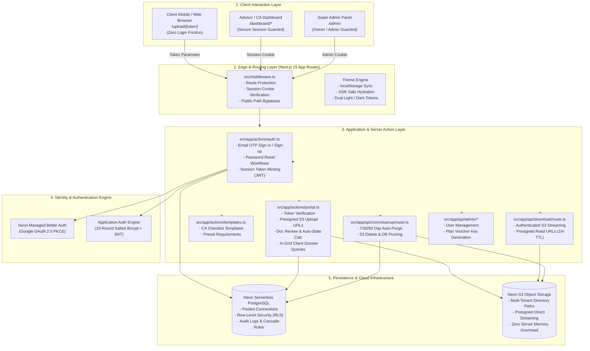
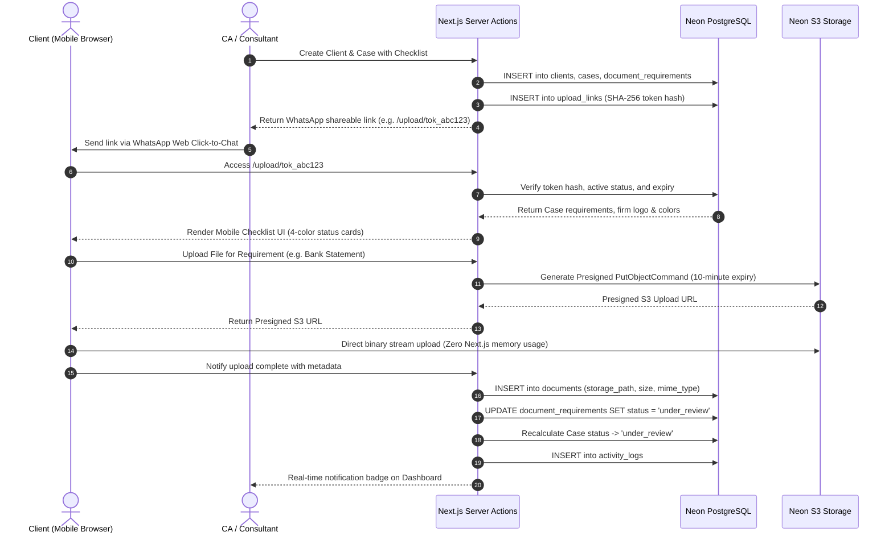
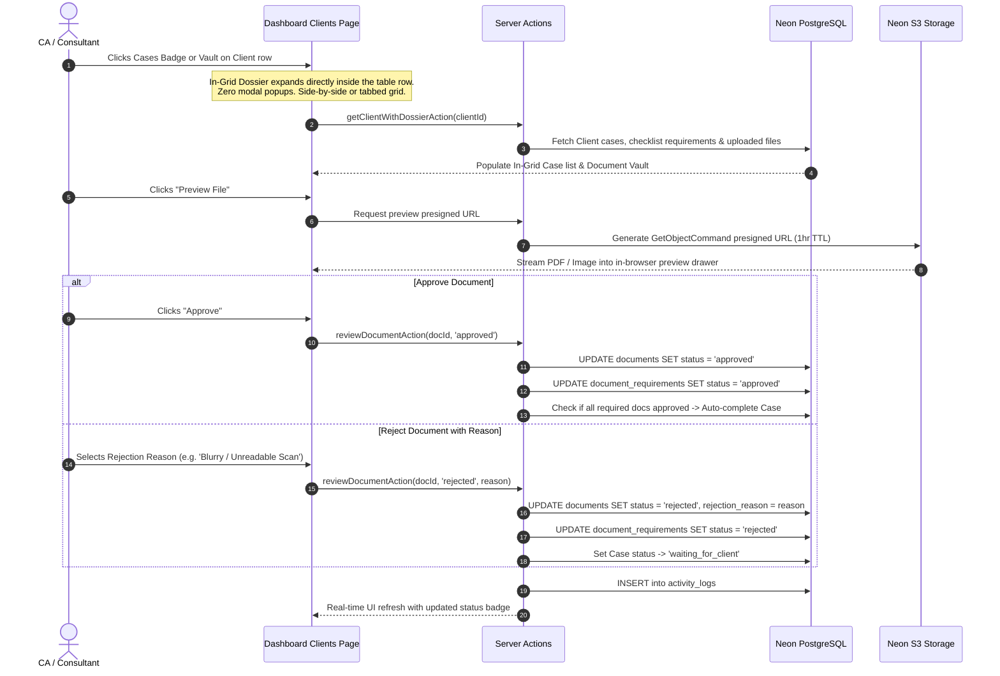
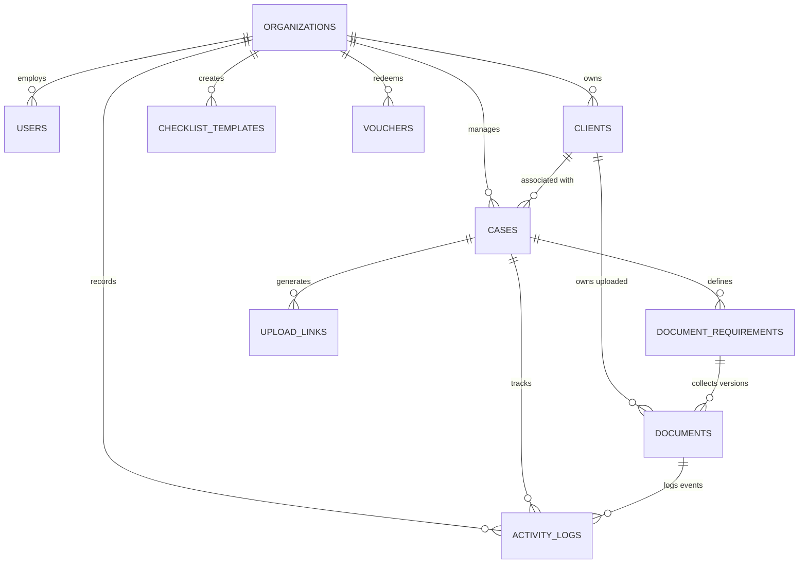
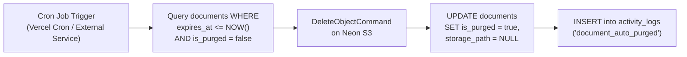

# DocuCollect — Complete Application Architecture Specification

> **System Version:** 3.0 (Production Architecture)  
> **Framework:** Next.js 15 (App Router, React 19, Server Actions)  
> **Database:** Neon Serverless PostgreSQL with Connection Pooling  
> **Storage:** Neon S3 Object Storage (`@aws-sdk/client-s3`)  
> **Auth Engines:** Neon Managed Better Auth (Google OAuth) + Salted Bcrypt & Email OTP + Stateless JWT  
> **Primary Audience:** Chartered Accountants (CAs), Tax Consultants, Advocates, Legal Advisors, Corporate Agencies  

---

## 1. Executive Summary & Problem Space

Professional service firms—particularly Chartered Accountants, tax practitioners, and law firms in India—frequently struggle with unstructured client document collection. Critical KYC, financial filings, and audit records arrive piecemeal across unorganized WhatsApp chats, disparate email chains, and photo dumps.

### Problems Solved by DocuCollect:
1. **WhatsApp & Email Chaos:** Scattered documents lead to missed deadlines, lost attachments, and unverified files.
2. **Client Login Friction:** Requiring clients to create an account, remember passwords, or download an app leads to massive friction and abandoned requests.
3. **Storage & Security Liabilities:** Storing multi-gigabyte client tax files permanently creates legal liabilities and database bloat.
4. **Lack of Structured Review:** Advisors lack clear visibility into which specific documents are missing, approved, or pending revisions.

### DocuCollect Solution:
DocuCollect provides an enterprise-grade, link-based document collection portal:
- **Zero-Friction Client Portal:** Clients click an encrypted WhatsApp link and upload directly from their phone camera or computer with **no account creation, no password, and no app install**.
- **Structured Dynamic Checklists:** Cases define exact required and optional files with instant status tags (*Missing*, *Under Review*, *Approved*, *Rejected*).
- **CA Review & Verification Suite:** Instant in-browser PDF/image preview, 1-click approvals, and customizable rejection templates.
- **In-Grid Client Dossier & Vault:** Embedded responsive client management without disruptive modal popups.
- **Automated Lifecycle & Storage Purge:** S3 object storage keeps databases light, and automated cron jobs permanently purge files after retention periods (7, 30, or 90 days).
- **SaaS Monetization & 30-Day Free Trial:** Zero-risk trial gating with manual UPI payment workflows and single-use voucher unlock keys.

---

## 2. System Architecture & Topology



---

## 3. Detailed Data Flow & Component Workflows

### 3.1 Client Upload Journey (Zero-Password Link)



---

### 3.2 CA Review, In-Grid Dossier & Verification Flow



---

## 4. Entity Relationship Model & Relational Schema



### 4.1 Schema Tables Reference

| Table | Primary Key | Key Columns | Purpose |
| :--- | :--- | :--- | :--- |
| **`organizations`** | `id` (UUID) | `name`, `slug`, `logo_url`, `branding_color`, `plan`, `trial_expires_at`, `is_locked`, `storage_used_bytes` | Multi-tenant root isolation entity. Controls 30-day trial status and plan tier. |
| **`users`** | `id` (UUID) | `organization_id`, `email`, `full_name`, `password_hash`, `role`, `email_verified` | Consultant and staff profiles with role-based access. |
| **`clients`** | `id` (UUID) | `organization_id`, `name`, `email`, `phone`, `company`, `address`, `notes` | Client dossier records owned by a firm. |
| **`cases`** | `id` (UUID) | `organization_id`, `client_id`, `title`, `service_type`, `reference_number`, `status`, `due_date` | Service engagements (e.g., ITR Filing, GST Audit, Company Setup). |
| **`document_requirements`**| `id` (UUID) | `case_id`, `name`, `description`, `is_required`, `allowed_types`, `max_size_mb`, `status`, `sort_order` | Individual checklist items needed for a case. |
| **`documents`** | `id` (UUID) | `requirement_id`, `case_id`, `client_id`, `version`, `file_name`, `storage_path`, `file_size`, `status`, `expires_at` | Uploaded physical file metadata pointing to Neon S3 storage. |
| **`upload_links`** | `id` (UUID) | `case_id`, `token_hash`, `token_prefix`, `expires_at`, `revoked_at`, `last_used_at` | Cryptographic upload links shared with clients. |
| **`checklist_templates`** | `id` (UUID) | `organization_id`, `name`, `service_type`, `requirements` (JSONB) | Pre-built reusable checklist templates for CAs. |
| **`activity_logs`** | `id` (UUID) | `organization_id`, `case_id`, `document_id`, `actor_type`, `action`, `metadata` | Comprehensive audit trail of every system action. |
| **`vouchers`** | `id` (UUID) | `code`, `plan`, `duration_days`, `is_redeemed`, `redeemed_by_org_id`, `created_at` | Single-use activation vouchers issued by Super Admins. |

---

## 5. Storage Architecture & Directory Partitioning

DocuCollect stores zero binary files in the database. All documents stream directly to **Neon S3 Object Storage** using multi-tenant directory partitioning.

### 5.1 Object Key Convention
```
org-{orgId:0-12}/{clientId:0-12}/{caseId:0-12}/{requirementId:0-12}/v{version}_{sanitized_filename}
```
*Example:*  
`org-e82a19b8cf1a/cl_92f1b80a/cs_119ab48f/rq_4810dc2e/v1_bank_statement_2025_26.pdf`

### 5.2 Storage Security Matrix
- **Bucket Visibility:** Completely private (`public = false`).
- **Direct Streaming:** Direct presigned S3 URLs prevent server memory bottleneck.
- **Short-Lived Presigned URLs:**
  - **Upload URL:** 10 minutes TTL.
  - **Download / Preview URL:** 1 hour TTL.
- **Sanitization:** Special characters and path traversal sequences (`../`) are stripped before generating storage keys.

---

## 6. Security & Multi-Tenancy Architecture

```
[ Request Origin: Client / Advisor ]
               │
               ▼
┌────────────────────────────────────────────────────────┐
│ 1. Edge Route Middleware (src/middleware.ts)           │
│    - Blocks unauthenticated access to /dashboard/*     │
│    - Blocks non-admin access to /admin                 │
│    - Verifies JWT and Better Auth session cookies      │
└──────────────────────────┬─────────────────────────────┘
                           │
                           ▼
┌────────────────────────────────────────────────────────┐
│ 2. Identity & Trial Guard (src/lib/auth)               │
│    - requireSession(): Extracts authenticated user ID  │
│    - TrialExpiryGuard: Verifies 30-day trial status    │
│    - Locks uploads if plan expired                     │
└──────────────────────────┬─────────────────────────────┘
                           │
                           ▼
┌────────────────────────────────────────────────────────┐
│ 3. Organization Scoping in Server Actions              │
│    - getAuthenticatedOrgId(): Resolves organization_id │
│    - Enforces WHERE organization_id = $orgId on queries│
│    - Prevents cross-tenant data leakage                │
└──────────────────────────┬─────────────────────────────┘
                           │
                           ▼
┌────────────────────────────────────────────────────────┐
│ 4. Cryptographic Link Verification (Public Uploads)   │
│    - Computes SHA-256 hash of incoming plaintext token │
│    - Compares against stored token_hash in upload_links│
│    - Validates revoked_at IS NULL AND expires_at > now │
└──────────────────────────┬─────────────────────────────┘
                           │
                           ▼
┌────────────────────────────────────────────────────────┐
│ 5. Database Row-Level Security (PostgreSQL)            │
│    - current_org_id() session parameter                │
│    - Hard SQL-level tenant isolation                   │
└────────────────────────────────────────────────────────┘
```

---

## 7. Automated Retention & Auto-Purge Lifecycle

To keep storage usage lean and protect sensitive financial records, DocuCollect features an automated retention engine:

### 7.1 Retention Policies by Plan
- **Trial Plan:** **7-day** retention.
- **Starter Plan:** **30-day** retention.
- **Professional Plan:** **90-day** retention.
- **Firm Plan:** **Custom retention settings** (configurable up to 365+ days).

### 7.2 Cron Purge Flow (`/api/cron/cleanup`)


---

## 8. Billing, Monetization & Super Admin Console

1. **Pricing Tiers:**
   - **Trial (30 days, ₹0):** 1 firm workspace, up to 10 active clients, reusable checklists, link-based uploads & review, limited retention.
   - **Starter (Initial offer, ₹399/mo, ₹3,999/yr):** Up to 50 active clients, checklist templates, secure upload links, document review & rejection reasons, basic activity history.
   - **Professional (₹799/mo, ₹7,999/yr):** Up to 200 active clients, multiple staff accounts & roles, expanded templates, storage & audit history, firm branding.
   - **Firm (Proposed, ₹1,499/mo, ₹14,999/yr):** Higher client (500+) & staff limits, detailed permissions & audit history, custom retention, priority support, tailored onboarding.
2. **Trial Expiration Guard (`TrialExpiryGuard`):** When the trial expires:
   - Dashboard views remain readable.
   - Creating new cases and sharing active upload links is paused.
   - User is guided to the **Billing** dashboard.
3. **Manual UPI / Bank Transfer Payment Workflow:**
   - User views the official UPI QR code and bank account details.
   - User completes payment and submits payment proof.
4. **Super Admin Control Center (`/admin`):**
   - **Registered Users Tab:** View all signed-up consultants, organization names, email verification status, trial expiration dates, and one-click account lock/unlock toggles.
   - **Payments & Subscriptions Tab:** View payment submissions and generate single-use voucher codes (e.g. `DOCU-START-30D`, `DOCU-PRO-365D`) to instantly unlock client plans.

---

## 9. Appearance & Theme Architecture (Light & Dark)

DocuCollect implements an interactive dual-theme design system:
- **Theme Provider (`src/contexts/ThemeContext.tsx`):** Coordinates `light`, `dark`, and `system` preferences, synchronized with `localStorage` and OS media queries.
- **1-Click Theme Switcher (`src/components/ui/ThemeToggle.tsx`):** Available in the public Navbar, Pricing, Auth, and Dashboard headers.
- **CSS Token Harmonization (`src/app/globals.css`):**
  - Fallback dark rules use `:not([class*="dark:"])` filters, ensuring explicit Tailwind utility classes take full precedence.
  - Guarantees WCAG 4.5:1+ contrast across all pages, badges, and form elements in both themes.
