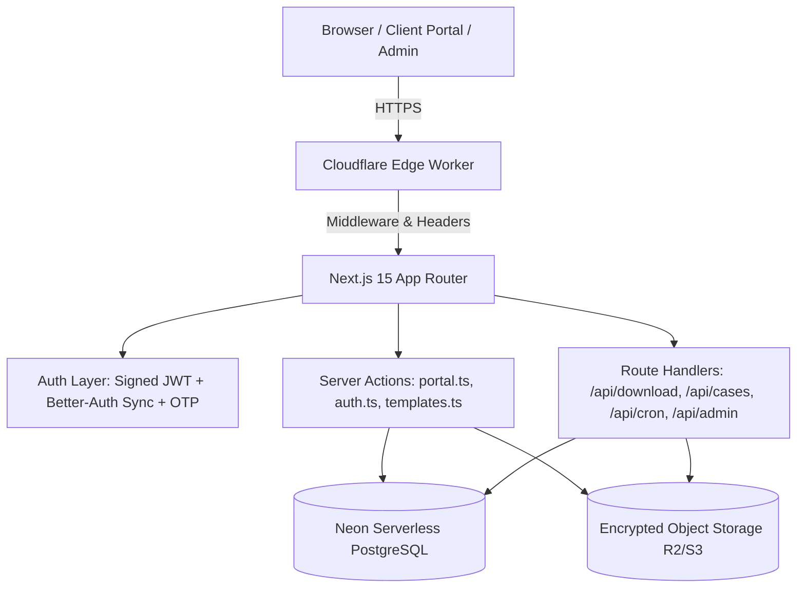

# DocuCollect — Attack Surface & Route Inventory (Phase 1)

**Target Application:** DocuCollect  
**Production URL:** `https://docucollect.ysh026.workers.dev/`  
**Deployment Platform:** Cloudflare Workers via OpenNext (`@opennextjs/cloudflare`, `wrangler.jsonc`)  
**Runtime:** Cloudflare Edge Worker / Node.js compatibility  
**Database:** Neon Serverless PostgreSQL (`@neondatabase/serverless`) with Row-Level Security (RLS)  
**Storage Provider:** Cloudflare R2 / AWS S3 Compatible Object Storage with AES-256-GCM client encryption  
**Assessment Date:** October 2026  
**Auditor:** Senior Application Security Engineer & Penetration Tester  

---

## 1. Application Architecture & Tech Stack

---

## 2. Complete Route Inventory & Authentication Matrix

| Route / Endpoint | Method | Authentication Required | Tenant Authorization Enforced | Sensitive Data Handled | Trust Boundary | Risk Level |
|---|---|---|---|---|---|---|
| `/` | `GET` | No (Public) | None | Public marketing copy | Public Internet | Low |
| `/pricing`, `/terms`, `/privacy`, `/refund`, `/security` | `GET` | No (Public) | None | Static legal & marketing content | Public Internet | Low |
| `/login` | `GET` | No (Redirects if auth) | None | Login interface | Public Internet | Low |
| `/signup` | `GET` | No (Redirects if auth) | None | Registration interface | Public Internet | Low |
| `/auth/callback` | `GET` | No (OAuth code/token) | Bound to OAuth email | Identity tokens, email, name | Third-party identity | Medium |
| `/upload/[token]` | `GET` | Client Upload Token | Scoped strictly to Token's `case_id` | Case client name, checklist requirements | Unauthenticated Client | **High** |
| `/dashboard` | `GET` | Yes (DocuCollect JWT) | `organization_id` session match | Firm activity, metrics, case summaries | Authenticated Advisor | High |
| `/dashboard/cases` | `GET` | Yes (DocuCollect JWT) | `organization_id` session match | Case list, client records, status | Authenticated Advisor | High |
| `/dashboard/cases/[id]` | `GET` | Yes (DocuCollect JWT) | `organization_id` session match | Full case details, requirements, file metadata | Authenticated Advisor | **Critical** |
| `/dashboard/clients` | `GET` | Yes (DocuCollect JWT) | `organization_id` session match | Client PII (phone, email, PAN, addresses) | Authenticated Advisor | **Critical** |
| `/dashboard/settings` | `GET` | Yes (DocuCollect JWT) | `organization_id` session match | Firm branding, phone, billing config | Authenticated Advisor | High |
| `/dashboard/billing` | `GET` | Yes (DocuCollect JWT) | `organization_id` session match | Subscription status, plan details | Authenticated Advisor | Medium |
| `/dashboard/audit` | `GET` | Yes (DocuCollect JWT) | `organization_id` session match | Audit trail logs, IP timestamps | Authenticated Advisor | High |
| `/admin` | `GET` | No (Protected by UI modal & API Secret) | Super-admin secret check | System overview, license keys, all firms | Administrative | **Critical** |
| `/api/download` | `GET` | Yes (Session OR Upload Token) | Strict Org Match OR Token Case Match | Decrypted PDF/image documents (PAN, Aadhaar, Bank Stmts) | Edge Storage Stream | **Critical** |
| `/api/cases/[id]` | `GET` | Yes (DocuCollect JWT) | Strict `organization_id` filter | Detailed case data & requirements | REST Consumer | High |
| `/api/cases/[id]/download-zip` | `GET` | Yes (DocuCollect JWT) | Strict `organization_id` filter | Bulk packaged client case documents in ZIP | Edge Memory & S3 | **Critical** |
| `/api/cases/review` | `POST` | Yes (DocuCollect JWT) | Document ownership match | Document approval/rejection state | REST Consumer | High |
| `/api/cron/cleanup-storage` | `GET` | CRON Secret / ADMIN Secret | Global system maintenance | Storage quota deletion & OTP purge | Automated Scheduler | High |
| `/api/admin/action` | `POST` | ADMIN Secret + ADMIN Email | Super-admin identity verification | User deactivation, license keys, firm deletion | Administrative Core | **Critical** |
| `/api/admin/payment-settings`| `GET/POST` | ADMIN Secret + ADMIN Email | Super-admin identity verification | Bank payment details, UPI ID, Razorpay keys | Administrative Core | **Critical** |
| `/api/logo/[orgId]` | `GET` | No (Public branding asset) | Read-only firm branding | Firm logo image buffer | Public Asset Cache | Low |

---

## 3. Trust Boundaries & Sensitive Data Flows

1. **Client Upload Portal Boundary (`/upload/[token]`):**
   - **Untrusted Actor:** Outside client or adversary holding a link.
   - **Sensitive Data:** Case checklist items, document upload destination.
   - **Enforcement:** SHA-256 hashed token lookup in `public.upload_links`, minimum 16-character length requirement, non-expired (`expires_at > now()`), and strictly scoped to single `case_id`.

2. **Cross-Tenant Boundary (`/dashboard/*`, `/api/download`, `/api/cases/*`):**
   - **Untrusted Actor:** Authenticated User from Tenant B attempting to view/modify Tenant A's documents, cases, or clients.
   - **Sensitive Data:** Client financial records, tax returns, identity cards, private notes.
   - **Enforcement:** Caller's `organizationId` extracted from signed cryptographic JWT session, enforced across all SQL filters (`WHERE organization_id = ${authOrgId}`), partitioned cache keys (`${authOrgId}:${caseId}`), and 403 Forbidden blocks.

3. **Storage & Decryption Boundary (`/api/download`, S3/R2):**
   - **Untrusted Actor:** Unauthorized user requesting raw storage paths or tampered byte buffers.
   - **Sensitive Data:** Unencrypted PDF / image documents.
   - **Enforcement:** Documents are encrypted at rest using AES-256-GCM (`DOCUENC1` envelope). Access checks happen **before** storage fetch; tampered ciphertexts fail tag validation.

4. **Privileged Administrative Boundary (`/api/admin/*`, `/api/cron/*`):**
   - **Untrusted Actor:** Regular users or internet scanners probing `/admin` or `/api/admin/action`.
   - **Sensitive Data:** All organizations, user deactivation, license key generation, database cleanup.
   - **Enforcement:** Constant-time `timingSafeEqual` secret verification, paired with authorized `adminEmail` check. No default fallbacks allowed in production.

---

## 4. High-Risk Code Locations Identified

1. `src/app/api/download/route.ts`: Core streaming endpoint for private documents.
2. `src/app/actions/portal.ts`: Master business logic and SQL queries for cases, clients, documents, and upload links.
3. `src/app/actions/auth.ts`: Authentication, password verification, signup, and OTP delivery.
4. `src/lib/auth/index.ts`: JWT signing, session verification, and cookie lifecycle.
5. `src/lib/storage/crypto.ts`: AES-256-GCM envelope encryption and key resolution.
6. `src/app/api/cron/cleanup-storage/route.ts`: Storage deletion and quota enforcement cron.
7. `src/middleware.ts`: Edge routing gatekeeper and security response header injector.
