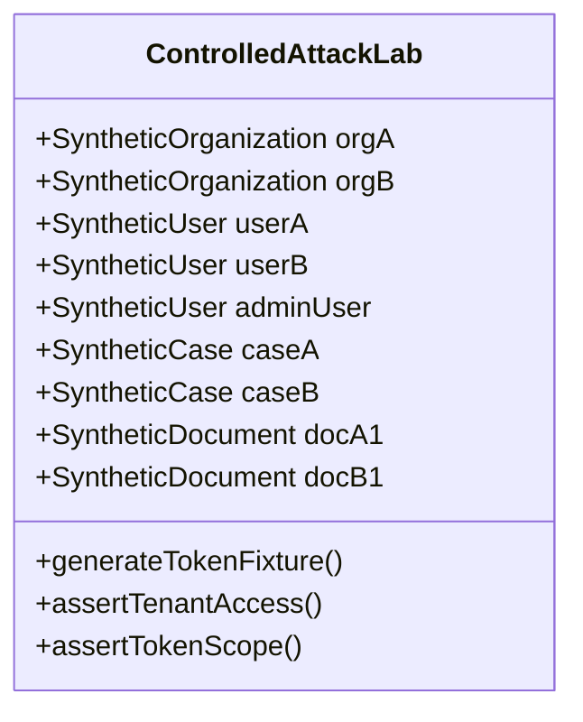

# DocuCollect — Test Plan & Controlled Attack Lab (Phase 2)

**Scope:** DocuCollect Security Assessment & Adversarial Penetration Testing  
**Environment:** Controlled Local/Staging Environment  
**Execution Runtime:** Node.js v24 & Edge Worker Environment with Neon PostgreSQL  
**Fixtures Module:** [`security-audit/tests/synthetic-lab.ts`](file:///d:/code/File%20Organizor/security-audit/tests/synthetic-lab.ts)  
**Automated Runner:** [`security-audit/tests/adversarial-suite.ts`](file:///d:/code/File%20Organizor/security-audit/tests/adversarial-suite.ts)  

---

## 1. Controlled Lab Architecture & Synthetic Fixtures

To ensure zero impact on production data, real users, or external services, all tests utilize strictly synthetic test fixtures identified by unmistakable `[TEST]` markers.

### Synthetic Identities
1. **Tenant Alpha:**
   - **Organization ID:** `org-synthetic-alpha-001` (`Alpha Legal Advisory Firm [TEST]`)
   - **User A (Owner):** `advisor.alpha@synthetic-test.local` (`user-synthetic-alpha-101`)
   - **Case A:** `case-synthetic-aaa-111` (`REF-ALPHA-9090`)
   - **Document A1:** `doc-synthetic-aaa-d1` (`alpha_audit_report.pdf`, marker: `SYNTHETIC_MARKER_ALPHA_TOP_SECRET`)

2. **Tenant Beta:**
   - **Organization ID:** `org-synthetic-beta-002` (`Beta Chartered Accountants [TEST]`)
   - **User B (Owner):** `advisor.beta@synthetic-test.local` (`user-synthetic-beta-202`)
   - **Case B:** `case-synthetic-bbb-222` (`REF-BETA-8080`)
   - **Document B1:** `doc-synthetic-bbb-d2` (`beta_balance_sheet.pdf`, marker: `SYNTHETIC_MARKER_BETA_CONFIDENTIAL`)

3. **Administrator:**
   - **Admin User:** `super.admin@synthetic-test.local` (`user-synthetic-admin-999`)
   - **Admin Secret:** Dynamically set during test runs; rejects legacy fallbacks.

---

## 2. Test Scope & Matrix

| Category | Objective | Attack Technique / Vector | Target File / Route |
|---|---|---|---|
| **A. Auth Bypass** | Verify protected resources reject unauthenticated callers | Direct HTTP requests without cookies, forged JWTs, malformed signatures | `/api/download`, `src/lib/auth/index.ts` |
| **B. Cross-Tenant IDOR** | Verify Tenant B cannot access Tenant A data | Identifier swapping on cases, documents, ZIP export, reviews | `/api/cases/[id]`, `/api/download`, `portal.ts` |
| **C. Upload Tokens** | Verify client tokens cannot be spoofed or escalated | Prefix substitution, 4-digit case ref guessing, expired tokens, cross-case token use | `getPortalCaseByToken`, `/api/download` |
| **D. Cryptography** | Verify data is encrypted at rest and integrity is validated | Bit-flipping tampered ciphertexts, checking magic header, raw byte inspection | `src/lib/storage/crypto.ts` |
| **E. Database & RLS** | Verify multi-tenant isolation at SQL & policy layer | Permissive NULL checks in RLS policies, unparameterized SQL | `neon/schema.sql` |
| **F. Injection** | Verify path traversal and input sanitization | Directory traversal `../` in ZIP export names, SQL injection payloads | `/api/cases/[id]/download-zip`, `portal.ts` |
| **G. Rate Limiting** | Verify brute force protection & secure OTP entropy | Sliding window bursts on login/signup/OTP, statistical OTP collision testing | `src/lib/rate-limit.ts`, `src/lib/auth/index.ts` |
| **H. Admin Endpoints** | Verify administrative and maintenance security | Legacy password brute force, timing attacks on cron secrets, unauthorized caller emails | `/api/admin/action`, `/api/cron/cleanup-storage` |
| **I. Headers & Config** | Verify modern browser defensive controls | Missing CSP/HSTS/nosniff headers, wildcard remote image hostnames | `src/middleware.ts`, `next.config.ts` |

---

## 3. Data Safety & Cleanup Protocol

1. **Non-Destructive Testing:** Test cases perform verification against in-memory models, cryptographic buffers, simulated database roles, and controlled localhost HTTP endpoints.
2. **Self-Contained Fixtures:** Any test-created temporary records use unique timestamps and are deleted immediately upon test teardown.
3. **No Secret Disclosure:** All tokens, keys, and session cookies are generated ephemerally and never logged to stdout or persistent files.
